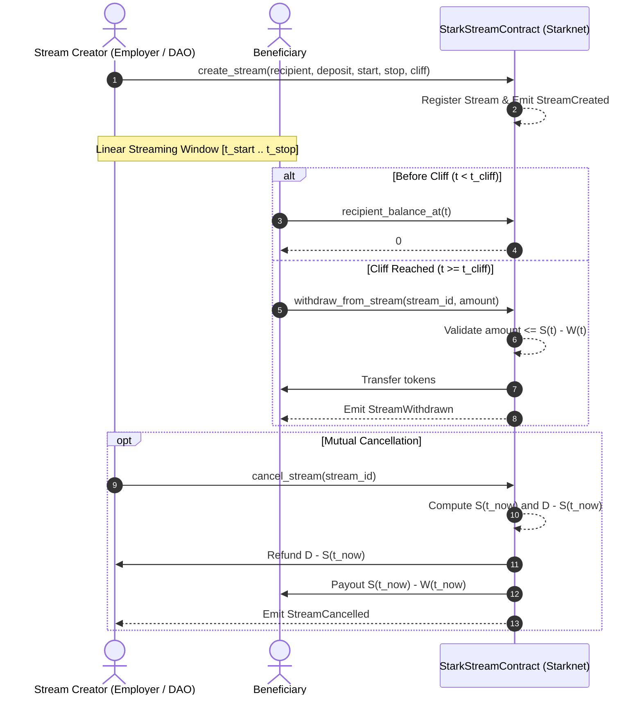

# StarkStream

[](https://github.com/ZengLLQ/stark-stream/actions)
[](https://opensource.org/licenses/MIT)
[](https://cairo-lang.org/)
[](https://starknet.io/)

**StarkStream** is a continuous money streaming and cliff-vesting smart contract protocol written in Cairo 2.21 for Starknet. It enables continuous, real-time per-second token disbursements, milestone cliff releases, partial asynchronous withdrawals, and mutual cancellation with mathematical balance conservation guarantees.

---

## Mathematical Specification

### 1. Continuous Streaming Rate Function

For any stream initialized with total principal $D$, start timestamp $t_{\text{start}}$, stop timestamp $t_{\text{stop}}$, and cliff timestamp $t_{\text{cliff}} \in [t_{\text{start}}, t_{\text{stop}}]$, the cumulative unlocked balance $S(t)$ at block timestamp $t$ is defined as:

$$
S(t) = \begin{cases}
0, & t < t_{\text{start}} \lor t < t_{\text{cliff}} \\
D \cdot \left( \frac{t - t_{\text{start}}}{t_{\text{stop}} - t_{\text{start}}} \right), & t_{\text{cliff}} \le t < t_{\text{stop}} \\
D, & t \ge t_{\text{stop}}
\end{cases}
$$

### 2. Available Recipient Balance

Accounting for cumulative previous withdrawals $W(t)$:

$$
B_{\text{recipient}}(t) = \max\Big(0, S(t) - W(t)\Big)
$$

### 3. Sender Unvested Balance

The unvested funds available for refund upon stream cancellation:

$$
B_{\text{sender}}(t) = D - S(t)
$$

### 4. Conservation of Principal Invariant

At all timestamps $t \in [0, \infty)$:

$$
B_{\text{sender}}(t) + S(t) \equiv D
$$

And post-cancellation:

$$
\text{Refund}_{\text{sender}} + \text{Payout}_{\text{recipient}} + W_{\text{prior}} \equiv D
$$

Zero funds can be created, lost, or trapped in contract state.

---

## Protocol Lifecycle



---

## Module Layout

```
src/
├── lib.cairo          # Module definitions and test harness entrypoint
├── types.cairo        # Stream storage structure and event payloads
├── math.cairo         # Exact per-second streaming and cliff tranche calculations
├── stark_stream.cairo # Starknet contract implementation (Storage, Map, and ABI)
└── tests.cairo        # Comprehensive unit tests verifying linear rate, cliff, and invariants
Scarb.toml             # Cairo 2.21 compiler and Starknet dependency manifest
```

---

## Build & Test

```bash
# Compile Sierra and CASM targets
scarb build

# Run unit and invariant test suite
scarb test
```

---

## License

This project is open-source under the [MIT License](LICENSE).
